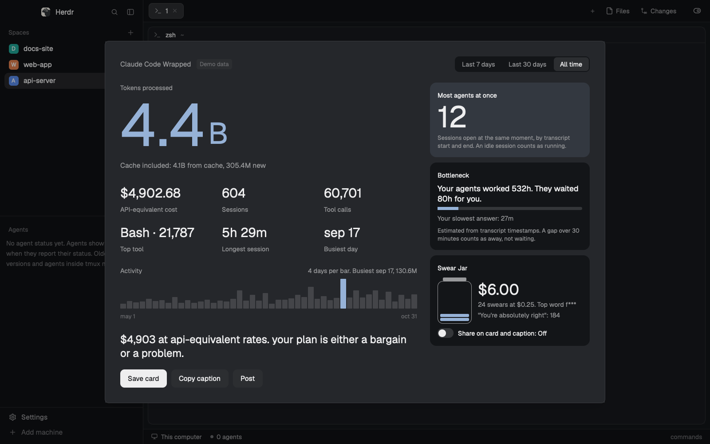

# Wrapped

An overlay for Herdr that shows your Claude Code stats as a card to share: tokens, cost, tools, your busiest day, the most agents you had going at once, how long they waited for you, and a swear jar.

A mod for the [Herdr](https://github.com/ogulcancelik/herdr) desktop app. Built for macOS.

Ask your agent to add it from [herdr.dev/mods](https://herdr.dev/gallery/?type=mods), or point it at this repo. It reads [the recipe](RECIPE.md) and every file first. By hand, copy `mods/wrapped` into `~/.config/herdr-app/mods` and merge `keys.json` into yours. `ctrl-shift-g` opens it.

It reads your transcripts on this machine, your own typed prompts included, to fill the jar. It keeps counts only, never your words, and makes no network calls. Nothing leaves your machine unless you post. The jar stays off the card and caption unless you turn it on. Cost is an API-equivalent estimate, not what you paid, and the Bottleneck is estimated from timestamps.

`python3 tests/test_helper.py`, `python3 tests/test_habits.py` and `node --test` run the checks.

MIT, see `LICENSE`.
