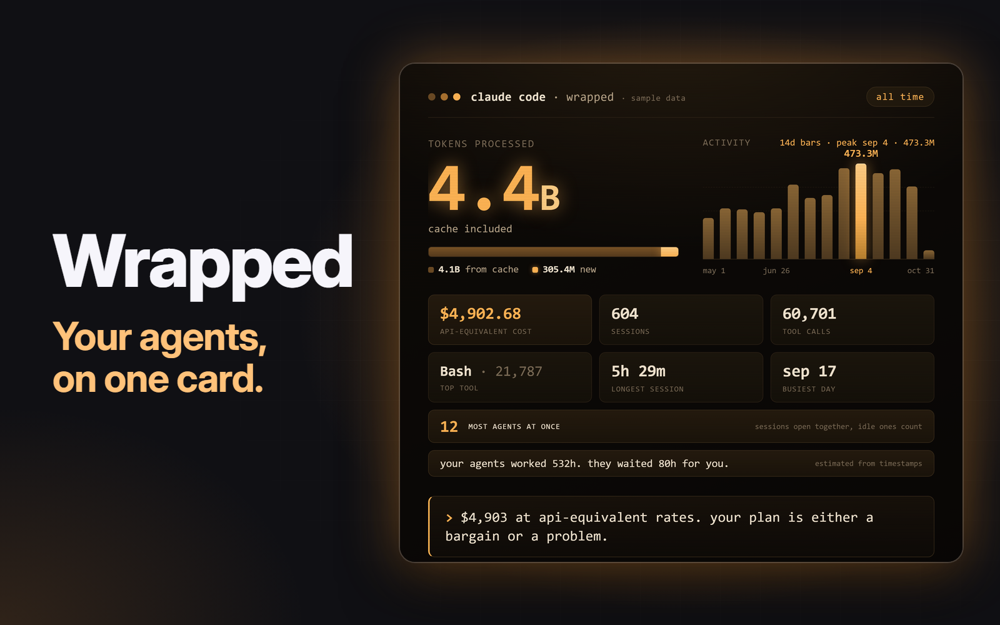

# Wrapped

An overlay that shows a person their Claude Code stats as a card to share. One big token number, what it would have cost, how they worked, the most agents they had going at once, how long their agents waited for them, a swear jar, and a dry line picked by their own numbers. A key opens it over whatever they're doing. From it they can save the card as a PNG, copy a caption, or start a post on X.

## What you see

A dialog, 940 by 680px, on `popover`, with 28px padding and 20px between regions. Colours are theme names only, and `accent` is the one strong colour. A header, then the story on the left and three blocks in a 300px column on the right, 24px apart, then the actions. The middle scrolls if the window is too short.

- **Header:** "Claude Code Wrapped" in 13px semibold `muted`. In demo mode, a "Demo data" tag beside it, 11px `dim` on `raised`, radius 4. At the right, the window switch: "Last 7 days", "Last 30 days" and "All time", 12px medium, each 26px high with 12px side padding and radius 6, in a `canvas` holder with radius 8 and 2px padding. The chosen one is `foreground` on `raised`, the others `muted`.
- **Left column**, 22px between regions:
  - **Hero:** "Tokens processed" in 12px medium `muted`. Under it the number, such as `4.4`, 112px bold `accent`, line height 1, with its unit, such as `B`, beside it at 56px semibold `accent`, 12px up from the bottom. Under that, 13px `muted`: "Cache included: 4.1B from cache, 305.4M new". When All time has days filled from Claude Code's stats file, it goes on: ". 97 days from Claude Code's stats, as its transcripts are gone."
  - **Stats:** two rows of three, 16px between columns and 14px between rows. Each is a value in 24px semibold `foreground`, cut with an ellipsis if too long, over a label in 12px `muted`. First row: API-equivalent cost (`$4,902.68`), Sessions, Tool calls. Second row: Top tool (`Bash · 21,787`), Longest session (`5h 29m`), Busiest day (`sep 17`).
  - **Activity strip:** a line in 12px `muted` with "Daily activity" at the left and "Busiest sep 17, 130.6M" at the right. Then bars in a row 56px high, 2px apart, radius 1, up to 56 of them, filling the width. The tallest is `accent`, others `input`, and a day with nothing is a 1px `border` line. The first and last dates sit under the ends in 11px `dim`. When the window has more than 56 days, days are grouped into equal bars, the left label reads "Activity", and the right one starts "4 days per bar."
  - **Punchline:** 20px semibold `foreground`, line height 1.3, wrapping. The text is the top line from `wrapped.py`, in its lowercase voice.
- **Right column**, 10px between blocks, each with 14px padding and radius 12. Block titles are 12px semibold `foreground`, and small print is 11px `muted`, line height 1.35.
  - **Most agents at once,** on `accent` at alpha `1f`: the count in 56px bold `foreground`, line height 1.05, then the small print "Sessions open at the same moment, by transcript start and end. An idle session counts as running."
  - **Bottleneck,** on `canvas`: "Your agents worked 532h. They waited 80h for you." in 15px semibold `foreground`, line height 1.3. A bar 6px high, radius 3, on `input`, with waited's share of the two in `accent`. "Your slowest answer: 27m" in 12px `muted`. Then the small print "Estimated from transcript timestamps. A gap over 30 minutes counts as away, not waiting." With no finished turn it says "No finished turns yet."
  - **Swear Jar,** on `canvas`: a drawn jar at the left, with a 44 by 7px lid in `muted`, radius 2, on a 64 by 80px body with a 1px `muted` border, radius 10 and 4px padding. Coins fill it from the bottom: up to nine rows 6px high, radius 2, 2px apart, in `accent`, full at 100 swears, and at least one row with anything in it. Beside it the fine, such as `$6.00`, 28px bold `foreground`. Under that in 12px `muted`, "24 swears at $0.25. Top word f***", or "Nothing in the jar.", and `"You're absolutely right": 184`. Along the bottom the toggle: a 30 by 18px track, radius 9, `input` when off and `accent` when on, with a 14px `foreground` knob at the left or right, and 12px `foreground` text reading "Share on card and caption: Off".
- **Actions**, 8px apart: "Save card" on `solid` with `solid_foreground`, then "Copy caption" and "Post" on `raised`. Each is 34px high with 14px side padding, radius 8, 13px medium. At the right, filling what's left, a note in 12px `muted`, line height 1.3, or `blocked` when something went wrong.

The card from Save card is `wrapped.py`'s own 1080 by 1080 dark amber card, not the overlay. Under its six tiles are full-width rows: the peak in amber, "MOST AGENTS AT ONCE" and "sessions open together, idle ones count", then "your agents worked 532h. they waited 80h for you." and "estimated from timestamps". With sharing on, a third row: the fine, "SWEAR JAR" and "24 swears, top word f***", with the rest of the card tightened to make room. A demo card reads "sample data" in small type after the title.

## How it behaves

- **Agent statuses:** it shows none. It reads transcripts from disk, not live agents, so working, blocked, done and idle don't change anything here.
- **Opening:** the key toggles it, and Esc or a click beside it closes it. It reads each time it opens, and not again while open.
- **Loading:** the middle shows an `accent` spinner and "Reading transcripts" in 13px `muted`, then "Reading transcripts: 1,204 of 6,000" as a long history goes through in passes. No part-counted numbers are shown, and the buttons sit at 45% opacity and do nothing.
- **The windows:** a press swaps the numbers at once, with no new read, and clears the note. Last 7 days and Last 30 days are that many days back, today included, by the UTC date a session started on. In demo mode, today is the newest day in `sample.py`.
- **The share toggle:** off every time the overlay opens, and a press flips it and clears the note. Off, the jar shows only in the overlay, and the card, the caption and the post link carry nothing from it. On, Save card adds the row, and Copy caption and Post add "swear jar: $6.00." It applies to both windows. It isn't remembered.
- **Save card:** the button reads "Saving" and the note "Saving the card". Then the note says "Saved to ~/Downloads/claude-code-wrapped-all-time-2026-11-05.png", with `last-7-days` or `last-30-days` in place of `all-time` for those windows, and `demo` in place of the date in demo mode. With no Chromium browser it writes the card as HTML next to where the PNG would go, and the note, in `blocked`, says "No Chromium browser found, so the card was saved as HTML: ... Open it and take a screenshot." If a browser fails or takes over 20 seconds the note gives that reason and the same HTML file.
- **Copy caption:** puts the X caption for the window in view on the clipboard. The note says "Caption copied."
- **Post:** runs `open` on an X compose link with that caption filled in. The note says a link can't attach an image, so the saved card has to be added by hand. Nothing posts by itself.
- **Hover:** a working button drops to 88% opacity.
- **Motion:** only the spinner, with `.frames`.
- **When it goes wrong,** the middle says so in 13px `blocked`, centred: "python3 couldn't start helper.py: ...", "helper.py stopped with code 1: ...", "helper.py didn't answer within 28 s", "helper.py printed something that isn't JSON", "Reading stopped getting further. ...", or "No Claude Code transcripts found. ...".
- **Nothing in a window:** 13px `muted`, "No Claude Code sessions in the last 7 days." (or 30), and the buttons wait.
- **Left-out files:** the note reads "2 transcripts couldn't be read and are left out."
- **Sessions** counts real sessions, by session id. A subagent's transcript isn't one. Its tokens and tool calls still count, except an API turn its parent's transcript already has.
- **Most agents at once** is the most sessions open at one moment. A session is open from the first timestamp in its transcript to the last. Runs with the same session id count as one, so a session's subagents fold into it. A session that ends at the exact moment another starts doesn't overlap it. A session with a single timestamp is open for that instant. Only runs in the window count, so Last 7 days leaves out a session that started before it.
- **Bottleneck** is estimated from transcript timestamps, on the main thread of each session:
  - Worked is the time from a prompt to the assistant's last record before the next prompt.
  - Waited is the time from there to the next prompt from the person.
  - The cap is 30 minutes. A gap at or under it is waiting, and a longer gap is away and adds nothing. Silence over 30 minutes inside a turn adds nothing to worked either, so a permission prompt left overnight isn't work.
  - Your slowest answer is the longest wait under the cap.
  - A session's last turn has no reply, so nothing is added after it.
  - A prompt from a program (an SDK prompt, a scheduled wake-up, a background task's notice) starts a turn, but the gap before it isn't waiting, because it wasn't the person answering.
  - Parallel sessions add up, so it's agent time, not clock time.
- **Swear Jar** reads only what the person typed: prompts marked `promptSource` `typed` or `queued`, and prompts with no `promptSource` in older transcripts unless an SDK sent them. It never reads tool results, system text, slash commands, accepted suggestions, subagent records or anything the assistant wrote.
  - Fenced code, inline code, quoted lines, indented lines, URLs and system tags are taken out first.
  - A prompt over 2,000 characters is taken for a paste and skipped whole.
  - Words count on word boundaries, in any case, $0.25 each: fuck, shit, damn, crap, asshole, bastard, bitch, bollocks, cunt, wtf, and their forms in `habits.py`. Scunthorpe, assassin and scrapped don't count, and neither does `fuck_it`.
  - The top word is masked: its first letter and a star for each of the rest.
- **"You're absolutely right"** is `wrapped.py`'s count of the assistant's own text, any case, main thread only. It's about the assistant, so it isn't part of the toggle, and it can be the card's punchline with sharing off.

## Built from

- One mod, `mods/wrapped/`, with `mod.json` `{ "place": "none", "title": "Wrapped", "overlay": { "width": 940, "height": 680 } }`. No layout change.
- `keys.json`: `{ "global": { "ctrl-shift-g": "mod.open:wrapped" } }`.
- `props`: `{ "demo": true }` uses the made-up data instead of the person's history. `mod.open` takes only a name, so demo mode opens another way: `herdr-app do tab.new '{"mod":"wrapped","props":{"demo":true}}'`, or `openOverlay({ mod: "wrapped", props: { demo: true }, width: 940, height: 680 })` from another mod.
- Files:
  - `main.js` runs the helper and holds the state.
  - `view.js` draws.
  - `logic.js` holds the helper arguments, reply reading and the words, with no Herdr imports.
  - `helper.py` finds and caches transcripts, counts the peak, and prints JSON or saves the card.
  - `habits.py` works out the Bottleneck and the Swear Jar. A prompt's text goes no further than this file, and only counts come out.
  - `sample.py` makes the demo's runs from a fixed seed: about 600 sessions from May to October 2026, 4.4B tokens, a peak of 12 on sep 17, 24 swears. They're invented, and go through the real stats.
  - `wrapped.py` is the script from `github.com/adamentwistle/claude-code-wrapped`, released here under MIT by its copyright holder. It makes the stats, punchlines, card, PNG, captions and X link. `examples/runs/` holds the three fixtures its selftest needs.
- The mod's `wrapped.py` differs from the source in these places. Stats with no `peak`, `bottleneck`, `jar` or `sample` key give the source's card and captions:
  - `parse_run`: usage is added up over every line of a reply, as `/stats` does, where the source keeps one line's. An `extra` reader, which adds `habits`, a list of API turns to skip, and an `is_subagent` flag. `wrapped_stats` counts sessions by distinct session id, leaving out subagents.
  - `CARD_STYLE`, `_CARD_BODY` and `html_card`: the rows and the sample tag.
  - `share_text`: those lines in each caption. The X caption drops to a shorter form when it would pass 280 characters.
  - `render_png`: a 20 second limit, a throwaway `--user-data-dir` so a browser already open can't take the job over, and a whole PNG counts as done, so a browser that keeps running after its screenshot is stopped.
  - `demo` and `card --demo` use `sample.py`.
  - The selftest's two dash checks are written as escapes.
- `herdr`: `appHome`, `exec`, `home`, `props`, `theme`. `cx`: `spawn`, `sleep`, `notify`, `write_to_clipboard`. `gpui-kit`: `View`, `div`, `.frames`. `gpui-base`: `v_flex`, `h_flex`.
- Programs:
  - `python3 -I -S -B <home>/mods/wrapped/helper.py read --cache <home>/data/wrapped/runs-cache.json`, with `--demo` in demo mode, again until it stops saying `partial`.
  - The same with `save --window all|7d|30d --out ~/Downloads`, plus `--jar` with sharing on. It starts a headless Chromium browser if it finds one. `$CLAUDE_WRAPPED_BROWSER` or `$CHROME_PATH` picks one.
  - `open <x link>`.
- `helper.py read` prints `{ "partial": false, "read": 566, "total": 566, "leftOut": 0, "windows": { "7d": {...}, "30d": {...}, "all": {...} } }`, and `{ "partial": true, "read", "total", "leftOut" }` until it's done. Each window is what the overlay draws, already formatted, or `{ "window", "empty": true }`. Its `share` has the caption and link without the jar, and `shareJar` with it. `save` prints `{ "saved", "kind": "png" }` or `{ "saved", "kind": "html", "noBrowser", "why" }`. Anything that fails prints `{ "error" }`.
- It looks in `$CLAUDE_CONFIG_DIR` and every `~/.claude*` folder, at `projects/`, through `wrapped.discover_profiles`, and reads each of those profiles' `stats-cache.json`. `--projects` and `--stats` name them instead, for tests.

## Watch out

- **Tell the person before adding it.** It runs `python3`, `open`, and on Save card a Chromium browser. It reads Claude Code's transcripts in `~/.claude*/projects` and `$CLAUDE_CONFIG_DIR`, outside its own folder, for reading only. That includes their prompts: it reads what they typed, on their machine, to fill the Swear Jar.
- **What it keeps.** No prompt text is shown, stored or returned. `helper.py` gets counts only, with the top word masked. It writes two things: `data/wrapped/runs-cache.json` under Herdr's home, with each session's token counts, times, session id, tool names and masked swear counts, but no project names or message text, and the card in `~/Downloads`. Its entries are keyed by a hash of each transcript's path, because the path holds the project's folder name.
- **Network and privacy:** the mod makes no network calls. Nothing leaves the machine unless the person posts: Post only opens a compose page in their browser, and they choose whether to send it. The card and the overlay never show project names or paths. A top tool's name does show, cut to its last part for MCP tools.
- **The jar is opt-in.** It's off by default and off on every open, and with it off the stats handed to the card and caption have no jar in them. Keep it that way: `card_stats` only adds `jar` when asked. Sharing a card with the overlay's own screenshot shows the jar regardless, since a screenshot isn't something the toggle can reach.
- **Cost is an estimate.** It's what the tokens would bill at API rates in `wrapped.py`'s price table, not what anyone paid. A plan is a flat fee. Unknown models are priced as Opus.
- **Built for macOS, and tested this far.** It was built on Windows 11 with Herdr 0.1.12. On Windows: `herdr-app check` in a private home, with the loading, error, empty, card, jar and no-turns states each forced into `init`; `wrapped.py selftest`; the tests in `tests/`; `helper.py` under `python3 -I -S -B` on 3.12; and a PNG through Chrome. On macOS with Herdr 0.1.13, in a real window with real keys and clicks: the key opening and closing it over a focused terminal, Esc, the overlay's layout in demo mode, the window switch (then All time and This month), the toggle, Save card through Chrome 145, Copy caption read back from the clipboard, Post opening X's compose page, demo mode with `tab.new`, and `helper.py`, the tests and the card under the stock `python3` 3.9. On Windows `open` doesn't exist, so Post says it failed.
- **`python3` is the login shell's.** `exec` runs in the person's real environment, so the `python3` it starts is the one their login shell finds, not the one on Herdr's own PATH. On a stock Mac that means the command line tools.
- **Chrome may not exit after its screenshot.** Chrome 145 on macOS writes the PNG and keeps running, so a whole PNG counts as done and the browser is stopped. Without that, every save waited out the 20 seconds and fell back to HTML.
- **The Bottleneck is an estimate.** Transcripts record when messages landed, not what anyone was doing. A permission prompt answered inside 30 minutes counts as worked, and a slow tool over 30 minutes doesn't. Keep the word "estimated" wherever the line goes.
- **Most agents at once can read high.** It comes from transcript start and end times, so an idle session counts as running, and a session resumed days later counts as open the whole time between. It's sessions, not subagents. Say that wherever the number goes.
- **The jar can miss and overcount.** Transcripts don't mark pasted text, so a short paste counts and a long typed rant doesn't. An older transcript with no `promptSource` can't show who typed it. Keep the word list short and on boundaries.
- **Claude Code deletes old transcripts, and /stats remembers them.** Transcripts go after `cleanupPeriodDays`, but the profile's `stats-cache.json`, which `/stats` reads, keeps a line per day: sessions, tool calls and tokens. All time takes a day from it when it knows of more sessions that day than the transcripts do, and the file's tokens with no day (older versions kept none per day) join the total. Every read profile's file is read, not only the active one's: Herdr starts the helper without the shell's `$CLAUDE_CONFIG_DIR` (it's set in `.zshrc`, which a non-interactive shell skips), so the active profile would depend on how Herdr was launched. The files are joined by day, taking the most of each count, so a copied file adds nothing. Two real profiles busy on the same day count as the busier one. Only counts are taken from it. The peak, the Bottleneck, the jar, the top tool and the punchline's other inputs stay the transcripts', and cost and the cache share for those days follow the transcripts' own rates.
- **Tokens and cost follow /stats' counting.** Claude Code writes one transcript line per content block of a reply (thinking, text, each tool call), and every line repeats the whole reply's usage. `/stats` adds up every line, and so does this mod, so its tokens match `/stats`. That counts a reply's usage once per streamed line, so it runs about twice what was billed, and the API-equivalent cost, worked out from the same tokens, runs high by the same amount. Tool calls still count once per tool call.
- **Busiest day is by tokens.** `/stats`' most active day is by messages, so the two can name different days.
- **Backup copies are left out unless asked for.** A `~/.claude*` folder whose name has `copy`, `backup` or `bak` in it, in any case, is taken for a copy: on the Mac it was built against these were `.claude copy`, `.claude-copy`, `.claude-BACKUP` and `.claude-backup-20260212`, while the real profiles were `.claude`, `.claude-work` and `.claude-eval`. The active profile is never left out. To read the copies too, put `{ "includeBackups": true }` in `data/wrapped/settings.json` under Herdr's home, beside the cache.
- **Several Claude folders add up.** `wrapped.py` alone reads the active one. This mod reads every profile, so totals can pass what `/stats` shows. The same path under two folders is one transcript and the larger is kept, because a copied `~/.claude` would otherwise double everything, and every session would overlap its own copy.
- **A subagent's file can repeat a parent's turn.** On one history, 7 of 16,373 API turns were in both. So a file under `<session>/subagents/` has its parent's `requestId`s read first, once per parent per pass, and those turns are skipped.
- **Nothing may be written under `mods/`.** A new file there makes Herdr reload the mod. That's why the cache is in `data/wrapped/`, and why `-B` is passed: `__pycache__` would land beside `helper.py`.
- **`-I` leaves the script's folder off `sys.path`,** so `import wrapped` fails until `helper.py` adds it.
- **`exec` stops at 30 s, with 8 MiB of output and no stdin.** So a pass stops parsing after 15 s and reports `partial`, each pass gets at least one file further, `helper.py` is given up on after 28 s, and Save allows 4 s for reading and 20 s for the browser. A first read of 784 MB in 566 files took 8.1 s with the Bottleneck and jar parsing, then 0.11 s once cached, with a 4 KB reply.
- **Cache key:** size and modified time per file, plus a hash of `wrapped.py` and `habits.py`, so a new price table or word list starts again.
- **No `setTimeout`, `clearTimeout` or `setInterval`.** The time limit is a race with `cx.sleep`.
- **`wrapped.py selftest` needs `examples/runs/`,** and nothing else uses it. A demo's windows end on the newest day in `sample.py`.
- **Days and months come from `wrapped.py`:** a session belongs to the UTC date it started on, so one started near midnight can land next door.
- **Some punchlines say "this year"** whatever the window. They're `wrapped.py`'s, kept as written.
- **Limits:** a file over 256 MiB is left out and counted, 56 bars, top tool cut to 16 characters.
- **Transcripts aren't a public format.** It relies on `sessionId`, `timestamp`, `type`, `requestId`, `isSidechain`, `promptSource`, `toolUseResult` and `message.usage`. If `promptSource` goes away, every prompt reads as an older one.

## Done when

- `herdr-app check mods/wrapped` passes.
- `python3 mods/wrapped/wrapped.py selftest` prints PASS.
- `python3 tests/test_helper.py`, `python3 tests/test_habits.py` and `node --test` pass from the repo's root.
- `python3 -I -S -B mods/wrapped/helper.py read --demo` prints JSON where `windows.all` has `tokens` `4.4`, `unit` `B`, `sessions` `604`, `peak.count` `12`, `bottleneck.worked` `532h`, `jar.count` `24`, and `windows.7d.window` is `last 7 days`.
- `python3 mods/wrapped/wrapped.py card --demo --out card.png` writes a card reading "sample data".
- `ctrl-shift-g` opens the overlay and shows the spinner, then the numbers. The key again closes it, and so does Esc.
- Opened again, the numbers show within a second.
- Last 7 days, Last 30 days and All time swap the numbers. With no sessions in a window it says so, and Save card, Copy caption and Post do nothing.
- The toggle reads Off on every open. With it off, a saved card and a pasted caption have no mention of the jar. With it on, both do. Closing and reopening puts it back to Off.
- Save card puts a 2160 by 2160 PNG in `~/Downloads`, and the note gives its path. With every Chromium browser hidden, it writes the `.html` file instead and says so.
- Copy caption, then paste: the text has the tokens, sessions, "most agents at once" and the agents' worked and waited times.
- Post opens X's compose page with that caption in it.
- After all that, `mods/wrapped/` has no new files, `data/wrapped/runs-cache.json` exists, and searching it for a word from a prompt finds nothing.
- With `python3` off the PATH, the overlay says python3 couldn't start the helper.
